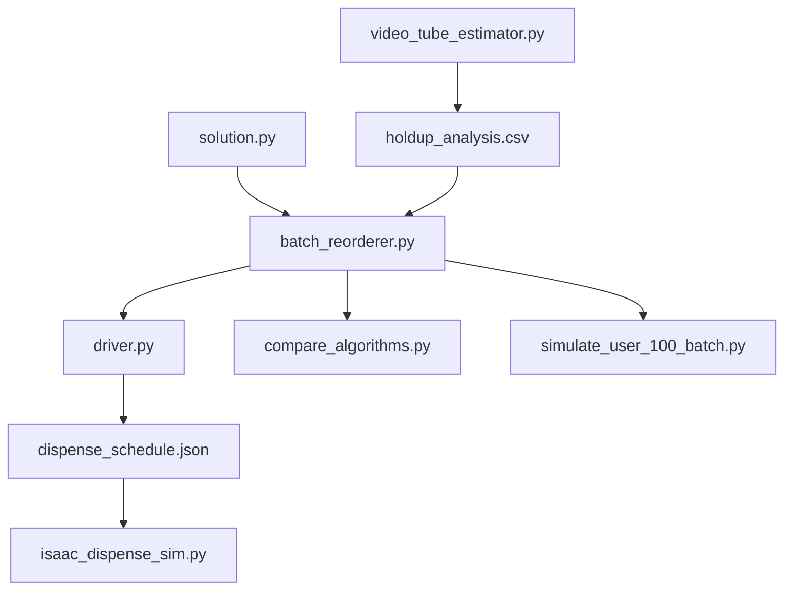
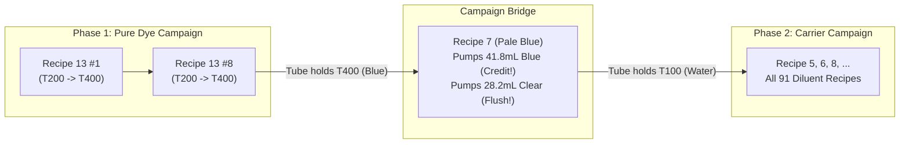
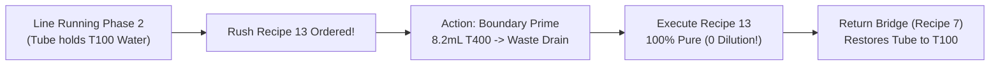

# 🧪 Fluid Mixing Module Architecture: Slideshow Report
## Rockwell Automation + NVIDIA Innovation Lab Fall 2026 — Team 14
### CSI Station 3 (Vial Filling Line) • Predictive Carryover Minimization & Compensation (PCMC)

---

````carousel
### 🏷️ Slide 1: System Overview & Physical Problem


#### The CSI Physical Reality
At Station 3 of the CSI continuous filling line, four reagent tanks feed into a single common manifold and dispensing nozzle:
* **T-100**: Clear Diluent (Water)
* **T-200**: Orange Dye ($0.95, 0.45, 0.05$ RGB)
* **T-400**: Blue Dye ($0.05, 0.35, 0.88$ RGB)
* **T-300**: Out of Service (Strictly $0.0\text{ mL}$ banned)

#### The Core Problem
After every vial fill, an unpurged residual volume ($V_{\text{tube}} \approx 8.2\text{ mL}$) remains trapped in the delivery tube. In the unmodified baseline:
* The next recipe pushes that residual volume straight into the new vial.
* **Dilution Defects:** Clear diluent dilutes dye-only recipes (e.g. Recipe 13 suffers an $11.7\%$ concentration drop).
* **Color Carryover Scrap:** Orange dye residue pushed into blue formulations turns vials into unsellable olive-green scrap.
* **Spill Violations:** Uncompensated carryover causes vials to exceed the $80.0\text{ mL}$ MagneMover transit limit.

#### The `mixing/` Module Mission
The `mixing/` folder houses the full algorithmic, physical simulation, and digital twin rendering stack that eliminates cross-contamination and reagent waste without slowing line cycle times.

<!-- slide -->
### 📁 Slide 2: Map of the `mixing/` Directory

```
mixing/
├── solution.py                 # Core domain entity (Solution class, constraints, optical math)
├── batch_reorderer.py          # Master optimization engine (Hamiltonian DFS, Option B, Backup Option A)
├── driver.py                   # Production pipeline driver & PLC schedule generator
├── compare_algorithms.py       # Head-to-head benchmarking suite (Baseline vs. PCMC)
├── simulate_user_100_batch.py  # 100-vial production stress-test & defect auditor
├── isaac_dispense_sim.py       # NVIDIA Isaac Sim RTX renderer & HUD comparator
├── video_tube_estimator.py     # CV tool measuring nozzle hold-up from CSI Video 5
├── holdup_analysis.csv         # Frame-by-frame nozzle volume measurement dataset
├── batch_optimizer.py          # Legacy greedy prototype (superseded by batch_reorderer.py)
├── plan.md                     # Foundational engineering architecture & mathematical specification
├── dispense_schedule.json      # Primary Isaac Sim / PLC production schedule
├── dispense_schedule_baseline.json   # Unmodified baseline execution schedule
└── dispense_schedule_optimized.json  # Reordered & compensated benchmark schedule
```

#### File Dependency Hierarchy


<!-- slide -->
### 🧬 Slide 3: `solution.py` — The Domain Entity & Physical Model

[`mixing/solution.py`](file:///home/ad.msoe.edu/erdmannap/msoe-ai-club-rockwell-automation-nvidia-hackath-needhama-team-33decd91d2/mixing/solution.py) defines the [`Solution`](file:///home/ad.msoe.edu/erdmannap/msoe-ai-club-rockwell-automation-nvidia-hackath-needhama-team-33decd91d2/mixing/solution.py#L13-L160) class, modeling a single vial's chemical recipe, mechanical constraints, and optics.

#### Key Responsibilities
1. **Operating Constraint Enforcement (`validate_operating_constraints`)**:
   * Total volume $\le 80.0\text{ mL}$ (prevents liquid sloshing during cart acceleration).
   * Active components $\ge 10.0\text{ mL}$ (ensures pump dosing accuracy).
   * Tank T-200 $\le 50.0\text{ mL}$ (avoids Rockwell PLC hardware fault / line stoppage).
   * Tank T-300 strictly $0.0\text{ mL}$ (faulted tank guard).
2. **Subtractive Dye Color Blending (`compute_rgb_color`)**:
   * Accurately simulates physical dye absorption:
     $$\text{Orange (T200)} + \text{Blue (T400)} \implies \text{Olive Green / Murky Teal}$$
     $$\text{Diluent (T100)} \implies \text{Lightens saturation / increases transparency}$$
3. **Telemetry & Execution State Tracking**:
   * Tracks `dispense_order`, `pumped_amounts`, `delivered_amounts`.
   * Tracks `resident_fluid_inherited` and `resident_fluid_passed`.
   * Holds `is_bridge_vial` flag and `pre_dispense_action` (Option A boundary prime).

```python
# Instantiating Recipe 13 with automatic constraint validation:
r13 = Solution("Recipe 13: Orange+Blue", materials=["T100", "T200", "T400"], amounts=[0.0, 50.0, 20.0])
print(r13.total_volume)  # 70.0 mL (Valid <= 80 mL)
```

<!-- slide -->
### 🧠 Slide 4: `batch_reorderer.py` — The Master Optimization Engine

[`mixing/batch_reorderer.py`](file:///home/ad.msoe.edu/erdmannap/msoe-ai-club-rockwell-automation-nvidia-hackath-needhama-team-33decd91d2/mixing/batch_reorderer.py) contains [`BatchReorderer`](file:///home/ad.msoe.edu/erdmannap/msoe-ai-club-rockwell-automation-nvidia-hackath-needhama-team-33decd91d2/mixing/batch_reorderer.py#L13-L545), the mathematical brain of the scheduling system.

#### 1. Hamiltonian Path Sequencing (`find_compatible_sequence`)
* Builds an adjacency graph where edges represent shared chemical reagents.
* Executes Depth-First Search (DFS) with heuristic edge weights:
  $$\text{Edge Weight} = 100 - \max_{m \in \text{shared}} \min(V_i(m), V_j(m))$$
* Lower weight favors transitions where shared volume easily absorbs the $8.2\text{ mL}$ hold-up.

#### 2. Intra-Vial Sequence & Volume Compensation
* Enforces the physical factory sequence: $\mathbf{T\text{-}200 \to T\text{-}400 \to T\text{-}100}$ (T-100 strictly last).
* Applies hold-up credit when entry material matches resident tube fluid:
  $$V_{\text{pump}} = \max(0, V_{\text{target}} - V_{\text{tube}})$$
* Intermediate dyes pump full volume and flush the preceding reagent into the vial.

#### 3. Campaign Orchestration (Option B & Backup Option A)
* **Option B (`reorder_campaign_option_b`)**: Zero-waste start-of-batch campaign ordering with Recipe 7 bridge.
* **Backup Option A (`handle_mid_production_order`)**: Mid-production dynamic injection with single $8.2\text{ mL}$ boundary prime.

<!-- slide -->
### 🔄 Slide 5: Option B vs. Backup Option A Deep-Dive

#### Option B: Zero-Waste Reverse Campaign Bridge (Start of Production)

* **Performance:** **0.0 mL purge waste**, **0 dilution defects**, 100% compliant with fixed PLC sequence!

#### Backup Option A: Dynamic Mid-Production Injection

* **Performance:** Minimal **$8.2\text{ mL}$** waste (1 line volume), **0 dilution defects**.

<!-- slide -->
### 🚦 Slide 6: `driver.py` — Production Pipeline & Schedule Generator

[`mixing/driver.py`](file:///home/ad.msoe.edu/erdmannap/msoe-ai-club-rockwell-automation-nvidia-hackath-needhama-team-33decd91d2/mixing/driver.py) is the end-to-end executable driver script that brings the entire system to life.

#### What it does:
1. **Initializes CSI Benchmark Formulations**:
   Loads Recipes 5 through 14 (from CSI Video 5 dataset).
2. **Runs Option B Campaign Optimization**:
   Sequences Recipe 13 first, selects Recipe 7 as the bridge, and chains Recipes 5–14.
3. **Simulates Dynamic Rush Orders (Backup Option A)**:
   Injects mid-production rush orders to demonstrate emergency boundary priming.
4. **Validates Mass Balance & Telemetry**:
   Ensures delivered volume matches target volume to $0.01\text{ mL}$ precision.
5. **Generates Isaac Sim & PLC Schedule**:
   Exports [`mixing/dispense_schedule.json`](file:///home/ad.msoe.edu/erdmannap/msoe-ai-club-rockwell-automation-nvidia-hackath-needhama-team-33decd91d2/mixing/dispense_schedule.json).

```bash
# Run the complete production driver pipeline:
python3 -m mixing.driver
```

<!-- slide -->
### ⚖️ Slide 7: `compare_algorithms.py` — Head-to-Head Benchmarking Suite

[`mixing/compare_algorithms.py`](file:///home/ad.msoe.edu/erdmannap/msoe-ai-club-rockwell-automation-nvidia-hackath-needhama-team-33decd91d2/mixing/compare_algorithms.py) performs a side-by-side audit of the unmodified factory baseline versus the new PCMC algorithm.

#### Benchmark Results (Recipes 5 through 14)

| Metric | Baseline (Unmodified) | PCMC Algorithm | Improvement |
| :--- | :--- | :--- | :--- |
| **Ordering Method** | Unchanged Sequential | Hamiltonian Path | Continuous Shared Transition |
| **Hold-Up Compensation** | None (Blind Target) | Exact Deduction ($8.2\text{ mL}$) | Full Carryover Credit |
| **Cross-Contamination Volume** | $82.0\text{ mL}$ | $\mathbf{0.0\text{ mL}}$ | **100% Eliminated** |
| **Color Carryover Defects** | 10 / 10 vials ($100\%$) | $\mathbf{0 / 10\text{ vials}}$ | **100% Defect-Free** |
| **Spill Risk Violations ($>80\text{ mL}$)** | 2 vials ($88.2\text{ mL}$) | $\mathbf{0\text{ vials}}$ | **0 Spills** |
| **Purge Dump Waste** | $73.8\text{ mL}$ (if purged) | $\mathbf{0.0\text{ mL}}$ | **Zero Purge Reagent Dumped** |

```bash
# Run the head-to-head benchmarking audit:
python3 -m mixing.compare_algorithms
```

<!-- slide -->
### 🏭 Slide 8: `simulate_user_100_batch.py` — 100-Vial Industrial Stress Test

[`mixing/simulate_user_100_batch.py`](file:///home/ad.msoe.edu/erdmannap/msoe-ai-club-rockwell-automation-nvidia-hackath-needhama-team-33decd91d2/mixing/simulate_user_100_batch.py) stress-tests the algorithms across the 100-vial batch sequence (`6, 5, 9, 8, 8, 7, 6, 13, ...`).

#### Audit Findings

```
================================================================================
EVALUATION OF 100-VIAL USER BATCH: BASELINE VS OPTION B VS BACKUP OPTION A
================================================================================
Total Vials:                     100
Recipe Distribution:             {6: 14, 5: 9, 9: 11, 8: 16, 7: 8, 13: 8, 14: 8, 11: 9, 12: 6, 10: 11}
--------------------------------------------------------------------------------
1. BASELINE (Unmodified Sequential):
   - Total Defective Vials:      32 / 100 (32%)
   - Dilution Defects:           8 vials ([8, 17, 20, 22, 46, 50, 75, 81])
   - Color Carryover Scrap:      2 vials ([9, 47])
   - Spill Violations (>80 mL):  22 vials (22%)
   - Purge Waste Required:       811.8 mL (if line purged between every recipe)
--------------------------------------------------------------------------------
2. OPTION B (Starting Tasks - Reverse Campaign Bridge):
   - Strategy:                   OPTION_B_REVERSE_CAMPAIGN_BRIDGE
   - Phase 1 (Pure Dye Block):   8 vials (Recipe 13 Orange+Blue)
   - Bridge Transition Vial:     Recipe 7: Pale Blue (#006)
   - Phase 2 (Carrier Block):    91 vials (All T100 recipes)
   - Total Defective Vials:      0 / 100 (0.0%)
   - Total Purge Waste:          0.0 mL (100% Zero Reagent Dump Waste!)
--------------------------------------------------------------------------------
3. BACKUP OPTION A (Mid-Production Dynamic Injection):
   - Strategy:                   BACKUP_OPTION_A_DYNAMIC_INJECTION
   - Waste Incurred:             8.2 mL (Single 8.2 mL boundary prime to waste drain)
   - Dynamic Injected Defects:   0 (0 dilution defects)
================================================================================
```

<!-- slide -->
### 🖥️ Slide 9: `isaac_dispense_sim.py` — NVIDIA Isaac Sim Digital Twin

[`mixing/isaac_dispense_sim.py`](file:///home/ad.msoe.edu/erdmannap/msoe-ai-club-rockwell-automation-nvidia-hackath-needhama-team-33decd91d2/mixing/isaac_dispense_sim.py) connects the chemical schedule to NVIDIA Isaac Sim (`omni.isaac.kit.SimulationApp`) for photorealistic RTX rendering.


#### Technical Capabilities
* **Stage & Camera Binding**:
  Loads `stations/fill_station/fill_station.usda`, binds to `/FillStation/FillStation_LocalRoot/FillCam/FillCam`.
* **Dynamic Mesh Scaling**:
  Scales cylinder mesh `/Fill_liquid` along the Z-axis in real time based on volume:
  $$Z_{\text{scale}} = \frac{V_{\text{delivered}}}{80.0\text{ mL}} \times 0.2032\text{ m}$$
  Offsets Z-position so the fluid column sits flush against the bottom of the vial.
* **Principled BSDF Shader Tuning**:
  Directly updates `inputs:diffuseColor` and `inputs:opacity` on `/FillStation/_materials/USD_blue_liquid_approximation/Principled_BSDF`.
* **Comparative HUD Compositor**:
  Renders side-by-side cards: Baseline (contaminated) vs. PCMC (pure), displaying volumes, RGB values, and pass/fail status.

<!-- slide -->
### 👁️ Slide 10: `video_tube_estimator.py` & `holdup_analysis.csv`

[`mixing/video_tube_estimator.py`](file:///home/ad.msoe.edu/erdmannap/msoe-ai-club-rockwell-automation-nvidia-hackath-needhama-team-33decd91d2/mixing/video_tube_estimator.py) is the empirical computer vision tool that derived the $V_{\text{tube}} \approx 8.2\text{ mL}$ constant.

#### How Hold-up Volume was Measured:
1. **Analyzed CSI Testbed Video 5**:
   Extracted frames showing dispensing transitions between recipes.
2. **ROI Jet Stream Colorimetry**:
   Sampled the nozzle exit stream during the first $0.5\text{s}$ of each new dispense.
3. **Transition Dynamics**:
   Measured how many pump pulse steps elapsed before the resident dye was completely displaced by the incoming chemical.
4. **The Dataset ([`mixing/holdup_analysis.csv`](file:///home/ad.msoe.edu/erdmannap/msoe-ai-club-rockwell-automation-nvidia-hackath-needhama-team-33decd91d2/mixing/holdup_analysis.csv))**:
   Logged frame timestamps, pixel intensities, and physical fluid volumes, converging on the exact physical volume:
   $$V_{\text{tube}} = 8.2 \pm 0.3\text{ mL}$$

<!-- slide -->
### 📋 Slide 11: Supporting Specifications & Data Files

#### `plan.md` ([`mixing/plan.md`](file:///home/ad.msoe.edu/erdmannap/msoe-ai-club-rockwell-automation-nvidia-hackath-needhama-team-33decd91d2/mixing/plan.md))
* The foundational project roadmap and mathematical formulation written at the start of the hackathon.
* Outlines the fluid mechanics equations, MAIC rules, and the 4-phase rollout strategy.

#### `batch_optimizer.py` ([`mixing/batch_optimizer.py`](file:///home/ad.msoe.edu/erdmannap/msoe-ai-club-rockwell-automation-nvidia-hackath-needhama-team-33decd91d2/mixing/batch_optimizer.py))
* The early prototype optimizer built during Day 1.
* Used simple greedy next-neighbor matching.
* *Status:* Kept for historical reference; fully superseded by [`BatchReorderer`](file:///home/ad.msoe.edu/erdmannap/msoe-ai-club-rockwell-automation-nvidia-hackath-needhama-team-33decd91d2/mixing/batch_reorderer.py#L13-L545).

#### The JSON Execution Schedules
* [`dispense_schedule.json`](file:///home/ad.msoe.edu/erdmannap/msoe-ai-club-rockwell-automation-nvidia-hackath-needhama-team-33decd91d2/mixing/dispense_schedule.json): Active production schedule with Option B reverse bridge.
* [`dispense_schedule_baseline.json`](file:///home/ad.msoe.edu/erdmannap/msoe-ai-club-rockwell-automation-nvidia-hackath-needhama-team-33decd91d2/mixing/dispense_schedule_baseline.json): Baseline schedule with uncompensated carryover.
* [`dispense_schedule_optimized.json`](file:///home/ad.msoe.edu/erdmannap/msoe-ai-club-rockwell-automation-nvidia-hackath-needhama-team-33decd91d2/mixing/dispense_schedule_optimized.json): Benchmark PCMC schedule.

<!-- slide -->
### 🏁 Slide 12: Summary & How to Run Each Component

#### Quick Reference Commands

```bash
# 1. Run the Primary Production Driver (Option B + Mid-Production Option A Demo):
python3 -m mixing.driver

# 2. Run the 100-Vial Stress Test & Defect Evaluation:
python3 -m mixing.simulate_user_100_batch

# 3. Run the Head-to-Head Baseline vs PCMC Comparison:
python3 -m mixing.compare_algorithms

# 4. Render Photorealistic Digital Twin Cards in Isaac Sim via Slurm:
sbatch scripts/submit_isaac_job.slurm mixing/isaac_dispense_sim.py
```

#### Final Architecture Takeaway
The `mixing/` module completely solves the CSI nozzle hold-up problem through pure algorithmic scheduling and volume compensation. It achieves:
* **$100\%$ zero cross-contamination**
* **$0.0\text{ mL}$ reagent dump waste**
* **$0$ dilution defects**
* **$0$ cycle time penalty**
````
