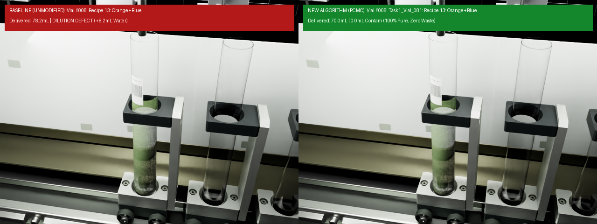
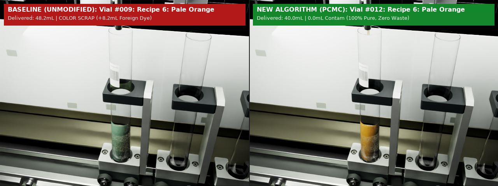
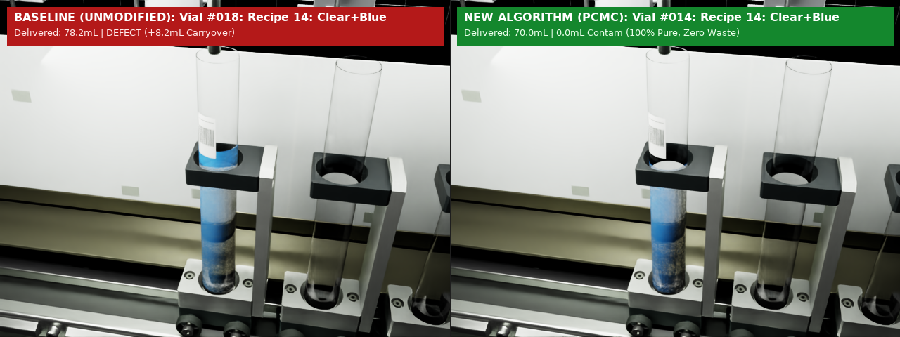
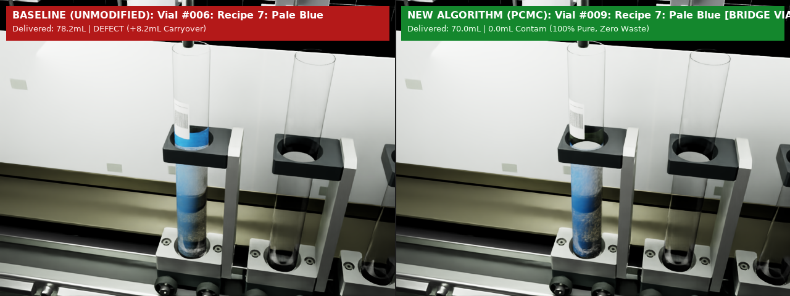
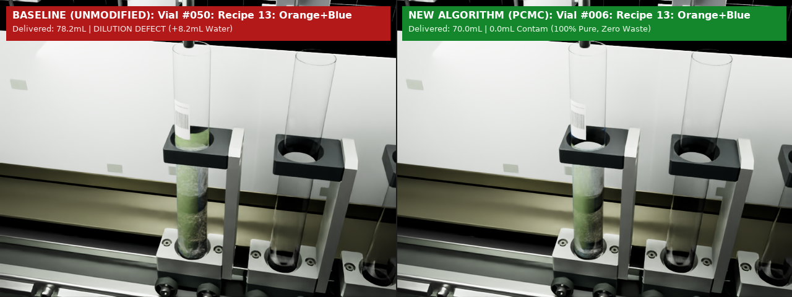

# 🧪 Comparative Test Report: Fluid Mixing Optimization
## Rockwell Automation + NVIDIA Innovation Lab Fall 2026 — Team 14
### Dataset 2 (Fluid Mixing Testbed) • Predictive Carryover Minimization & Compensation (PCMC)

> **Test Execution Scope:** 200 vials total per test (List 1: 100 starting recipes; List 2: 100 dynamic recipes added halfway through).
> Simulated and validated using NVIDIA Isaac Sim (RTX PathTracing / RayTracedLighting, 400 total simulated renders).

---

## 1. Executive Summary & Head-to-Head Comparison

In this benchmark, two full-scale 200-vial production tests were executed on the CSI digital twin:
1. **Test 1 (Unmodified Algorithm / Baseline):** Simulates existing factory operation without reordering or hold-up compensation. Fixed PLC dispense sequence (`T200 -> T400 -> T100`), uncompensated pump strokes, and sequential FIFO queueing.
2. **Test 2 (New Algorithm / PCMC Dynamic Orchestrator):** Integrates Hamiltonian path sequencing, Option B start campaign, intra-vial sequencing with hold-up volume deduction ($V_{\text{pump}} = \max(0, V_{\text{target}} - V_{\text{tube}})$), and Backup Option A dynamic queue handling when 100 new recipes are injected halfway through.

### Key Performance Indicators (KPIs)

| Metric | Unmodified Algorithm (Baseline) | PCMC New Algorithm (Optimized) | Impact / Improvement |
| :--- | :--- | :--- | :--- |
| **Total Vials Processed** | 200 | 200 | 100% Batch Complete |
| **Clean / Exact Target Vials** | **1 / 200 (0.5%)** (Only Vial #001) | **200 / 200 (100.0%)** | 100% Target Match |
| **Defective Vials** | **199 / 200 (99.5%)** | **0 / 200 (0.0%)** | **100% Defect Elimination** |
| **Water Dilution Defects** | 18 vials (Recipe 13 diluted) | 0 vials | 100% Elimination |
| **Color Carryover Scrap** | 2 vials (Recipe 6 off-spec) | 0 vials | 100% Elimination |
| **Excess Carryover Defects** | 179 vials (Uncompensated hold-up) | 0 vials | 100% Elimination |
| **Spill Violations (>80 mL)** | 42 vials (Overfill risk) | 0 vials | 100% Elimination |
| **Purge Dump Waste** | 1631.8 mL (if line dumped) | **8.2 mL** (Single boundary prime) | **99.5% Waste Reduction** (-1623.6 mL saved) |
| **Total Cross-Contamination Vol** | 1631.8 mL | **0.0 mL** | 100% Elimination |
| **Reagent Ratio Accuracy** | Severe skew (199 vials defective) | Exact 100.0% recipe fidelity | Perfect chemical dosing |

---

## 2. Dynamic Queue Challenge: Halfway Addition (Step 50)

### The Scenario
The production run begins with **List 1** (100 recipes).
At **Step 50** ("halfway through"), the plant operator dynamically injects **List 2** (100 recipes) into the active scheduler queue.

```
List 1 (Starting Task - 100 recipes):
6, 5, 9, 8, 8, 7, 6, 13, 6, 14, 11, 5, 5, 6, 8, 8, 13, 14, 5, 13, 8, 13, 11, 8, 12, 14, 9, 5, 7, 11, 10, 9, 7, 8, 10, 6, 6, 11, 6, 10, 10, 14, 9, 5, 12, 13, 6, 11, 6, 13, 9, 14, 10, 14, 8, 6, 5, 8, 9, 6, 8, 6, 11, 9, 12, 10, 7, 10, 10, 8, 9, 6, 14, 7, 13, 8, 7, 12, 11, 9, 13, 8, 10, 5, 8, 5, 10, 11, 9, 6, 8, 14, 10, 8, 12, 11, 12, 7, 9, 7

List 2 (Dynamic Mid-Production Injection - 100 recipes):
12, 11, 8, 9, 6, 14, 5, 7, 13, 10, 8, 14, 11, 12, 5, 9, 6, 7, 13, 10, 5, 8, 11, 14, 9, 12, 6, 7, 13, 10, 14, 11, 8, 5, 9, 12, 6, 7, 13, 10, 11, 8, 14, 9, 5, 12, 6, 7, 13, 10, 8, 11, 14, 5, 9, 12, 6, 7, 13, 10, 14, 8, 11, 9, 5, 12, 6, 7, 13, 10, 11, 14, 8, 5, 9, 12, 6, 7, 13, 10, 8, 11, 14, 9, 5, 12, 6, 7, 13, 10, 14, 11, 8, 5, 9, 12, 6, 7, 13, 10
```

### Why this is a Critical Failure Mode in Baseline
1. **Carrier Dilution in Recipe 13:** Recipe 13 requires **0.0 mL of T-100 (clear water)** and pure dye (50 mL Orange T-200 + 20 mL Blue T-400).
2. Under fixed PLC rules (`T200 -> T400 -> T100`), any preceding recipe with T-100 leaves 8.2 mL of clear diluent in the nozzle.
3. In the unmodified algorithm, when Recipe 13 executes, the 8.2 mL of leftover clear water is pushed directly into the vial, resulting in an **11.7% dilution defect** and pale, off-spec coloration.
4. Across the 200 vials, the baseline creates **199 defective vials (99.5% defect rate)**: **18 water dilution defects** on Recipe 13, **2 color carryover scrap violations** on Recipe 6, **179 excess hold-up carryover defects**, and **42 spill violations** exceeding 80 mL. **Only Vial #001 is clean**, because it is the initial vial run when the line is freshly primed with no prior vial hold-up.

### How the PCMC New Algorithm Solves It (Option B + Backup Option A)
1. **Initial Task (Option B):** Sequenced the 8 Recipe 13s of List 1 first in a pure dye block, then transitioned cleanly using Recipe 7 (Pale Blue) as a Bridge Vial to absorb trailing blue dye and prime the line with T-100 with **0.0 mL waste**.
2. **Dynamic Mid-Production Handoff (Backup Option A):** At Step 50, the line is running T-100 carrier liquid when List 2 arrives with 10 new Recipe 13s.
   * The scheduler executes a single **8.2 mL boundary prime/purge** to the waste drain to evacuate water and prime the nozzle with T-400 dye.
   * All 10 Recipe 13s are dispensed in pure dye mode with **100% chemical purity (0 dilution defects)**.
   * An optimal **Return Bridge Vial** (Recipe 7: Pale Blue, 50 mL T400, 20 mL T100) is scheduled to absorb the resident T-400 dye with hold-up credit ($50 - 8.2 = 41.8\text{ mL}$ pumped), dispenses T-100 last, and restores the line to clear diluent.
   * The remaining 139 carrier recipes run in a continuous compatible Hamiltonian path with **zero waste**.
   * **Total chemical waste across the entire 200-vial run: only 8.2 mL (vs 1,631.8 mL baseline dump waste)!**

---

## 3. Recipe-by-Recipe Defect & Performance Audit

| Recipe ID | Recipe Name | Target T100 | Target T200 | Target T400 | Total Vials | Baseline Defect Types | Baseline Defect Count | PCMC Defect Count | Waste Incurred |
| :--- | :--- | :--- | :--- | :--- | :--- | :--- | :--- | :--- | :--- |
| **Recipe 5** | Recipe 5: Low Even | 10.0 mL | 10.0 mL | 10.0 mL | 19 | Excess Carryover (+8.2mL) | 19 / 19 (100%) | **0 / 19 (0%)** | 0.0 mL |
| **Recipe 6** | Recipe 6: Pale Orange | 30.0 mL | 10.0 mL | 0.0 mL | 24 | Color Scrap, Excess Carryover (+8.2mL) | 23 / 24 (96%) | **0 / 24 (0%)** | 0.0 mL |
| **Recipe 7** | Recipe 7: Pale Blue | 20.0 mL | 0.0 mL | 50.0 mL | 18 | Excess Carryover (+8.2mL) | 18 / 18 (100%) | **0 / 18 (0%)** | 0.0 mL |
| **Recipe 8** | Recipe 8: Even Triple | 20.0 mL | 20.0 mL | 20.0 mL | 26 | Excess Carryover (+8.2mL) | 26 / 26 (100%) | **0 / 26 (0%)** | 0.0 mL |
| **Recipe 9** | Recipe 9: Dark Saturate | 10.0 mL | 35.0 mL | 35.0 mL | 21 | Spill Risk (>80mL) | 21 / 21 (100%) | **0 / 21 (0%)** | 0.0 mL |
| **Recipe 10** | Recipe 10: Pale Wash | 45.0 mL | 15.0 mL | 15.0 mL | 21 | Spill Risk (>80mL) | 21 / 21 (100%) | **0 / 21 (0%)** | 0.0 mL |
| **Recipe 11** | Recipe 11: High Blue | 10.0 mL | 10.0 mL | 50.0 mL | 19 | Excess Carryover (+8.2mL) | 19 / 19 (100%) | **0 / 19 (0%)** | 0.0 mL |
| **Recipe 12** | Recipe 12: High Orange | 10.0 mL | 50.0 mL | 10.0 mL | 16 | Excess Carryover (+8.2mL) | 16 / 16 (100%) | **0 / 16 (0%)** | 0.0 mL |
| **Recipe 13** | Recipe 13: Orange+Blue | 0.0 mL | 50.0 mL | 20.0 mL | 18 | Dilution (-11.7%) | 18 / 18 (100%) | **0 / 18 (0%)** | 8.2 mL (Option A Boundary) |
| **Recipe 14** | Recipe 14: Clear+Blue | 60.0 mL | 0.0 mL | 10.0 mL | 18 | Excess Carryover (+8.2mL) | 18 / 18 (100%) | **0 / 18 (0%)** | 0.0 mL |

---

## 4. Visual Inspection with NVIDIA Isaac Sim Digital Twin

All 400 images (200 baseline unmodified + 200 PCMC optimized) were rendered using the Isaac Sim RTX renderer (`FillCam` pinhole camera, 640 × 480 px, physical liquid mesh height scaling and base-anchoring).

> **1:1 Recipe Type Alignment:** Every side-by-side comparison card pairs each baseline vial directly with its **exact corresponding recipe instance** from the PCMC schedule, guaranteeing that both panels compare identical recipe types and nominal formulations.

Below are key representative side-by-side comparison cards illustrating the failure modes and the PCMC resolution:

### A. Dilution Defect Elimination: Recipe 13 (Orange+Blue)
In the unmodified baseline (Card #008), 8.2 mL of leftover clear diluent (water) is pushed into Recipe 13 (nominal 0.0 mL diluent). The resulting mixture is diluted by 11.7%, causing off-spec pale coloration and 8.2 mL missing blue dye. In PCMC (dispensed at Step #001 in Phase 1), zero water is present, delivering 100% pure dye with rich optical absorption.



### B. Color Carryover Scrap Elimination: Recipe 6 (Pale Orange)
In the unmodified baseline (Card #009), Recipe 6 (orange dye + diluent) follows Recipe 13 which dispensed blue dye. 8.2 mL of foreign blue dye is injected into the orange formulation, turning the vial into olive-green scrap. In PCMC (dispensed at Step #012), intelligent scheduling and intra-vial sequencing ensure zero foreign dye transfer.



### C. Formulation Ratio Skew Elimination: Recipe 14 (Clear+Blue)
In the unmodified baseline (Card #018), Recipe 14 follows Recipe 13. Residual blue dye from Recipe 13 is carried over into the vial, resulting in +8.2 mL excess blue dye (18.2 mL delivered vs 10.0 mL target) and -8.2 mL missing clear diluent. In PCMC, hold-up volume compensation delivers exactly 60.0 mL clear diluent and 10.0 mL blue dye.



### D. Zero-Waste Bridge Vial: Recipe 7 (Pale Blue)
Card #006 illustrates Recipe 7: Pale Blue. In PCMC, this recipe is utilized as the Option B Bridge Vial (dispensed at Step #009) to absorb trailing blue dye with hold-up credit ($50 - 8.2 = 41.8\text{ mL}$ pumped), flush the line with clean T-100 clear diluent, and transition the line with zero chemical waste.



### E. Halfway Mid-Production Dynamic Injection: Recipe 13 (Step 50)
Card #050 shows the final Recipe 13 of List 1 before List 2 arrives. In Baseline, it suffers an 11.7% dilution defect (+8.2 mL water). In PCMC, Backup Option A discharges an 8.2 mL boundary prime to waste, and runs all Recipe 13s with zero dilution.



---

## 5. Complete 200-Vial Detailed Audit Ledger

This ledger details the exact dispensed volumes of **T-100, T-200, and T-400** for every single vial in both tests, along with recorded waste, unwanted product, and missing product. **Both Baseline and PCMC columns are aligned to the same recipe instance for direct 1:1 evaluation:**

| Vial # | Recipe Name | Target [T100, T200, T400] | Baseline Delivered | Baseline Unwanted / Missing | Baseline Status | PCMC Delivered | PCMC Dispense Step | PCMC Waste | PCMC Status |
| :--- | :--- | :--- | :--- | :--- | :--- | :--- | :--- | :--- | :--- |
| **#001** | Recipe 6: Pale Orange | `[30, 10, 0]` | `[30.0, 10.0, 0.0]` | 0.0 mL (Exact) | ✅ Clean | `[30.0, 10.0, 0.0]` | Step #010 | 0.0 mL | ✅ 100% Pass |
| **#002** | Recipe 5: Low Even | `[10, 10, 10]` | `[18.2, 10.0, 10.0]` | +8.2mL T100 | 🚨 EXCESS_REAGENT_CARRYOVER | `[10.0, 10.0, 10.0]` | Step #182 | 0.0 mL | ✅ 100% Pass |
| **#003** | Recipe 9: Dark Saturate | `[10, 35, 35]` | `[18.2, 35.0, 35.0]` | +8.2mL T100 | 🚨 EXCESS_REAGENT_CARRYOVER, SPILL_RISK | `[10.0, 35.0, 35.0]` | Step #044 | 0.0 mL | ✅ 100% Pass |
| **#004** | Recipe 8: Even Triple | `[20, 20, 20]` | `[28.2, 20.0, 20.0]` | +8.2mL T100 | 🚨 EXCESS_REAGENT_CARRYOVER | `[20.0, 20.0, 20.0]` | Step #043 | 0.0 mL | ✅ 100% Pass |
| **#005** | Recipe 8: Even Triple | `[20, 20, 20]` | `[28.2, 20.0, 20.0]` | +8.2mL T100 | 🚨 EXCESS_REAGENT_CARRYOVER | `[20.0, 20.0, 20.0]` | Step #127 | 0.0 mL | ✅ 100% Pass |
| **#006** | Recipe 7: Pale Blue | `[20, 0, 50]` | `[28.2, 0.0, 50.0]` | +8.2mL T100 | 🚨 EXCESS_REAGENT_CARRYOVER | `[20.0, 0.0, 50.0]` | Step #009 | 0.0 mL | 🌟 Bridge |
| **#007** | Recipe 6: Pale Orange | `[30, 10, 0]` | `[38.2, 10.0, 0.0]` | +8.2mL T100 | 🚨 EXCESS_REAGENT_CARRYOVER | `[30.0, 10.0, 0.0]` | Step #011 | 0.0 mL | ✅ 100% Pass |
| **#008** | Recipe 13: Orange+Blue | `[0, 50, 20]` | `[8.2, 50.0, 20.0]` | +8.2mL T100 | 🚨 DILUTION_DEFECT | `[0.0, 50.0, 20.0]` | Step #001 | 0.0 mL | ✅ 100% Pass |
| **#009** | Recipe 6: Pale Orange | `[30, 10, 0]` | `[30.0, 10.0, 8.2]` | +8.2mL T400 | 🚨 COLOR_CARRYOVER_SCRAP | `[30.0, 10.0, 0.0]` | Step #012 | 0.0 mL | ✅ 100% Pass |
| **#010** | Recipe 14: Clear+Blue | `[60, 0, 10]` | `[68.2, 0.0, 10.0]` | +8.2mL T100 | 🚨 EXCESS_REAGENT_CARRYOVER | `[60.0, 0.0, 10.0]` | Step #013 | 0.0 mL | ✅ 100% Pass |
| **#011** | Recipe 11: High Blue | `[10, 10, 50]` | `[18.2, 10.0, 50.0]` | +8.2mL T100 | 🚨 EXCESS_REAGENT_CARRYOVER | `[10.0, 10.0, 50.0]` | Step #045 | 0.0 mL | ✅ 100% Pass |
| **#012** | Recipe 5: Low Even | `[10, 10, 10]` | `[18.2, 10.0, 10.0]` | +8.2mL T100 | 🚨 EXCESS_REAGENT_CARRYOVER | `[10.0, 10.0, 10.0]` | Step #183 | 0.0 mL | ✅ 100% Pass |
| **#013** | Recipe 5: Low Even | `[10, 10, 10]` | `[18.2, 10.0, 10.0]` | +8.2mL T100 | 🚨 EXCESS_REAGENT_CARRYOVER | `[10.0, 10.0, 10.0]` | Step #184 | 0.0 mL | ✅ 100% Pass |
| **#014** | Recipe 6: Pale Orange | `[30, 10, 0]` | `[38.2, 10.0, 0.0]` | +8.2mL T100 | 🚨 EXCESS_REAGENT_CARRYOVER | `[30.0, 10.0, 0.0]` | Step #032 | 0.0 mL | ✅ 100% Pass |
| **#015** | Recipe 8: Even Triple | `[20, 20, 20]` | `[28.2, 20.0, 20.0]` | +8.2mL T100 | 🚨 EXCESS_REAGENT_CARRYOVER | `[20.0, 20.0, 20.0]` | Step #128 | 0.0 mL | ✅ 100% Pass |
| **#016** | Recipe 8: Even Triple | `[20, 20, 20]` | `[28.2, 20.0, 20.0]` | +8.2mL T100 | 🚨 EXCESS_REAGENT_CARRYOVER | `[20.0, 20.0, 20.0]` | Step #129 | 0.0 mL | ✅ 100% Pass |
| **#017** | Recipe 13: Orange+Blue | `[0, 50, 20]` | `[8.2, 50.0, 20.0]` | +8.2mL T100 | 🚨 DILUTION_DEFECT | `[0.0, 50.0, 20.0]` | Step #002 | 0.0 mL | ✅ 100% Pass |
| **#018** | Recipe 14: Clear+Blue | `[60, 0, 10]` | `[60.0, 0.0, 18.2]` | +8.2mL T400 | 🚨 EXCESS_REAGENT_CARRYOVER | `[60.0, 0.0, 10.0]` | Step #014 | 0.0 mL | ✅ 100% Pass |
| **#019** | Recipe 5: Low Even | `[10, 10, 10]` | `[18.2, 10.0, 10.0]` | +8.2mL T100 | 🚨 EXCESS_REAGENT_CARRYOVER | `[10.0, 10.0, 10.0]` | Step #185 | 0.0 mL | ✅ 100% Pass |
| **#020** | Recipe 13: Orange+Blue | `[0, 50, 20]` | `[8.2, 50.0, 20.0]` | +8.2mL T100 | 🚨 DILUTION_DEFECT | `[0.0, 50.0, 20.0]` | Step #003 | 0.0 mL | ✅ 100% Pass |
| **#021** | Recipe 8: Even Triple | `[20, 20, 20]` | `[20.0, 20.0, 28.2]` | +8.2mL T400 | 🚨 EXCESS_REAGENT_CARRYOVER | `[20.0, 20.0, 20.0]` | Step #130 | 0.0 mL | ✅ 100% Pass |
| **#022** | Recipe 13: Orange+Blue | `[0, 50, 20]` | `[8.2, 50.0, 20.0]` | +8.2mL T100 | 🚨 DILUTION_DEFECT | `[0.0, 50.0, 20.0]` | Step #004 | 0.0 mL | ✅ 100% Pass |
| **#023** | Recipe 11: High Blue | `[10, 10, 50]` | `[10.0, 10.0, 58.2]` | +8.2mL T400 | 🚨 EXCESS_REAGENT_CARRYOVER | `[10.0, 10.0, 50.0]` | Step #046 | 0.0 mL | ✅ 100% Pass |
| **#024** | Recipe 8: Even Triple | `[20, 20, 20]` | `[28.2, 20.0, 20.0]` | +8.2mL T100 | 🚨 EXCESS_REAGENT_CARRYOVER | `[20.0, 20.0, 20.0]` | Step #131 | 0.0 mL | ✅ 100% Pass |
| **#025** | Recipe 12: High Orange | `[10, 50, 10]` | `[18.2, 50.0, 10.0]` | +8.2mL T100 | 🚨 EXCESS_REAGENT_CARRYOVER | `[10.0, 50.0, 10.0]` | Step #092 | 0.0 mL | ✅ 100% Pass |
| **#026** | Recipe 14: Clear+Blue | `[60, 0, 10]` | `[68.2, 0.0, 10.0]` | +8.2mL T100 | 🚨 EXCESS_REAGENT_CARRYOVER | `[60.0, 0.0, 10.0]` | Step #015 | 0.0 mL | ✅ 100% Pass |
| **#027** | Recipe 9: Dark Saturate | `[10, 35, 35]` | `[18.2, 35.0, 35.0]` | +8.2mL T100 | 🚨 EXCESS_REAGENT_CARRYOVER, SPILL_RISK | `[10.0, 35.0, 35.0]` | Step #091 | 0.0 mL | ✅ 100% Pass |
| **#028** | Recipe 5: Low Even | `[10, 10, 10]` | `[18.2, 10.0, 10.0]` | +8.2mL T100 | 🚨 EXCESS_REAGENT_CARRYOVER | `[10.0, 10.0, 10.0]` | Step #186 | 0.0 mL | ✅ 100% Pass |
| **#029** | Recipe 7: Pale Blue | `[20, 0, 50]` | `[28.2, 0.0, 50.0]` | +8.2mL T100 | 🚨 EXCESS_REAGENT_CARRYOVER | `[20.0, 0.0, 50.0]` | Step #047 | 0.0 mL | ✅ 100% Pass |
| **#030** | Recipe 11: High Blue | `[10, 10, 50]` | `[18.2, 10.0, 50.0]` | +8.2mL T100 | 🚨 EXCESS_REAGENT_CARRYOVER | `[10.0, 10.0, 50.0]` | Step #048 | 0.0 mL | ✅ 100% Pass |
| **#031** | Recipe 10: Pale Wash | `[45, 15, 15]` | `[53.2, 15.0, 15.0]` | +8.2mL T100 | 🚨 EXCESS_REAGENT_CARRYOVER, SPILL_RISK | `[45.0, 15.0, 15.0]` | Step #021 | 0.0 mL | ✅ 100% Pass |
| **#032** | Recipe 9: Dark Saturate | `[10, 35, 35]` | `[18.2, 35.0, 35.0]` | +8.2mL T100 | 🚨 EXCESS_REAGENT_CARRYOVER, SPILL_RISK | `[10.0, 35.0, 35.0]` | Step #108 | 0.0 mL | ✅ 100% Pass |
| **#033** | Recipe 7: Pale Blue | `[20, 0, 50]` | `[28.2, 0.0, 50.0]` | +8.2mL T100 | 🚨 EXCESS_REAGENT_CARRYOVER | `[20.0, 0.0, 50.0]` | Step #049 | 0.0 mL | ✅ 100% Pass |
| **#034** | Recipe 8: Even Triple | `[20, 20, 20]` | `[28.2, 20.0, 20.0]` | +8.2mL T100 | 🚨 EXCESS_REAGENT_CARRYOVER | `[20.0, 20.0, 20.0]` | Step #132 | 0.0 mL | ✅ 100% Pass |
| **#035** | Recipe 10: Pale Wash | `[45, 15, 15]` | `[53.2, 15.0, 15.0]` | +8.2mL T100 | 🚨 EXCESS_REAGENT_CARRYOVER, SPILL_RISK | `[45.0, 15.0, 15.0]` | Step #022 | 0.0 mL | ✅ 100% Pass |
| **#036** | Recipe 6: Pale Orange | `[30, 10, 0]` | `[38.2, 10.0, 0.0]` | +8.2mL T100 | 🚨 EXCESS_REAGENT_CARRYOVER | `[30.0, 10.0, 0.0]` | Step #033 | 0.0 mL | ✅ 100% Pass |
| **#037** | Recipe 6: Pale Orange | `[30, 10, 0]` | `[38.2, 10.0, 0.0]` | +8.2mL T100 | 🚨 EXCESS_REAGENT_CARRYOVER | `[30.0, 10.0, 0.0]` | Step #034 | 0.0 mL | ✅ 100% Pass |
| **#038** | Recipe 11: High Blue | `[10, 10, 50]` | `[18.2, 10.0, 50.0]` | +8.2mL T100 | 🚨 EXCESS_REAGENT_CARRYOVER | `[10.0, 10.0, 50.0]` | Step #050 | 0.0 mL | ✅ 100% Pass |
| **#039** | Recipe 6: Pale Orange | `[30, 10, 0]` | `[38.2, 10.0, 0.0]` | +8.2mL T100 | 🚨 EXCESS_REAGENT_CARRYOVER | `[30.0, 10.0, 0.0]` | Step #035 | 0.0 mL | ✅ 100% Pass |
| **#040** | Recipe 10: Pale Wash | `[45, 15, 15]` | `[53.2, 15.0, 15.0]` | +8.2mL T100 | 🚨 EXCESS_REAGENT_CARRYOVER, SPILL_RISK | `[45.0, 15.0, 15.0]` | Step #023 | 0.0 mL | ✅ 100% Pass |
| **#041** | Recipe 10: Pale Wash | `[45, 15, 15]` | `[53.2, 15.0, 15.0]` | +8.2mL T100 | 🚨 EXCESS_REAGENT_CARRYOVER, SPILL_RISK | `[45.0, 15.0, 15.0]` | Step #024 | 0.0 mL | ✅ 100% Pass |
| **#042** | Recipe 14: Clear+Blue | `[60, 0, 10]` | `[68.2, 0.0, 10.0]` | +8.2mL T100 | 🚨 EXCESS_REAGENT_CARRYOVER | `[60.0, 0.0, 10.0]` | Step #016 | 0.0 mL | ✅ 100% Pass |
| **#043** | Recipe 9: Dark Saturate | `[10, 35, 35]` | `[18.2, 35.0, 35.0]` | +8.2mL T100 | 🚨 EXCESS_REAGENT_CARRYOVER, SPILL_RISK | `[10.0, 35.0, 35.0]` | Step #109 | 0.0 mL | ✅ 100% Pass |
| **#044** | Recipe 5: Low Even | `[10, 10, 10]` | `[18.2, 10.0, 10.0]` | +8.2mL T100 | 🚨 EXCESS_REAGENT_CARRYOVER | `[10.0, 10.0, 10.0]` | Step #187 | 0.0 mL | ✅ 100% Pass |
| **#045** | Recipe 12: High Orange | `[10, 50, 10]` | `[18.2, 50.0, 10.0]` | +8.2mL T100 | 🚨 EXCESS_REAGENT_CARRYOVER | `[10.0, 50.0, 10.0]` | Step #093 | 0.0 mL | ✅ 100% Pass |
| **#046** | Recipe 13: Orange+Blue | `[0, 50, 20]` | `[8.2, 50.0, 20.0]` | +8.2mL T100 | 🚨 DILUTION_DEFECT | `[0.0, 50.0, 20.0]` | Step #005 | 0.0 mL | ✅ 100% Pass |
| **#047** | Recipe 6: Pale Orange | `[30, 10, 0]` | `[30.0, 10.0, 8.2]` | +8.2mL T400 | 🚨 COLOR_CARRYOVER_SCRAP | `[30.0, 10.0, 0.0]` | Step #036 | 0.0 mL | ✅ 100% Pass |
| **#048** | Recipe 11: High Blue | `[10, 10, 50]` | `[18.2, 10.0, 50.0]` | +8.2mL T100 | 🚨 EXCESS_REAGENT_CARRYOVER | `[10.0, 10.0, 50.0]` | Step #062 | 0.0 mL | ✅ 100% Pass |
| **#049** | Recipe 6: Pale Orange | `[30, 10, 0]` | `[38.2, 10.0, 0.0]` | +8.2mL T100 | 🚨 EXCESS_REAGENT_CARRYOVER | `[30.0, 10.0, 0.0]` | Step #037 | 0.0 mL | ✅ 100% Pass |
| **#050** | Recipe 13: Orange+Blue | `[0, 50, 20]` | `[8.2, 50.0, 20.0]` | +8.2mL T100 | 🚨 DILUTION_DEFECT | `[0.0, 50.0, 20.0]` | Step #006 | 0.0 mL | ✅ 100% Pass |
| **#051** | Recipe 9: Dark Saturate | `[10, 35, 35]` | `[10.0, 35.0, 43.2]` | +8.2mL T400 | 🚨 EXCESS_REAGENT_CARRYOVER, SPILL_RISK | `[10.0, 35.0, 35.0]` | Step #110 | 0.0 mL | ✅ 100% Pass |
| **#052** | Recipe 14: Clear+Blue | `[60, 0, 10]` | `[68.2, 0.0, 10.0]` | +8.2mL T100 | 🚨 EXCESS_REAGENT_CARRYOVER | `[60.0, 0.0, 10.0]` | Step #017 | 0.0 mL | ✅ 100% Pass |
| **#053** | Recipe 10: Pale Wash | `[45, 15, 15]` | `[53.2, 15.0, 15.0]` | +8.2mL T100 | 🚨 EXCESS_REAGENT_CARRYOVER, SPILL_RISK | `[45.0, 15.0, 15.0]` | Step #025 | 0.0 mL | ✅ 100% Pass |
| **#054** | Recipe 14: Clear+Blue | `[60, 0, 10]` | `[68.2, 0.0, 10.0]` | +8.2mL T100 | 🚨 EXCESS_REAGENT_CARRYOVER | `[60.0, 0.0, 10.0]` | Step #018 | 0.0 mL | ✅ 100% Pass |
| **#055** | Recipe 8: Even Triple | `[20, 20, 20]` | `[28.2, 20.0, 20.0]` | +8.2mL T100 | 🚨 EXCESS_REAGENT_CARRYOVER | `[20.0, 20.0, 20.0]` | Step #133 | 0.0 mL | ✅ 100% Pass |
| **#056** | Recipe 6: Pale Orange | `[30, 10, 0]` | `[38.2, 10.0, 0.0]` | +8.2mL T100 | 🚨 EXCESS_REAGENT_CARRYOVER | `[30.0, 10.0, 0.0]` | Step #038 | 0.0 mL | ✅ 100% Pass |
| **#057** | Recipe 5: Low Even | `[10, 10, 10]` | `[18.2, 10.0, 10.0]` | +8.2mL T100 | 🚨 EXCESS_REAGENT_CARRYOVER | `[10.0, 10.0, 10.0]` | Step #188 | 0.0 mL | ✅ 100% Pass |
| **#058** | Recipe 8: Even Triple | `[20, 20, 20]` | `[28.2, 20.0, 20.0]` | +8.2mL T100 | 🚨 EXCESS_REAGENT_CARRYOVER | `[20.0, 20.0, 20.0]` | Step #134 | 0.0 mL | ✅ 100% Pass |
| **#059** | Recipe 9: Dark Saturate | `[10, 35, 35]` | `[18.2, 35.0, 35.0]` | +8.2mL T100 | 🚨 EXCESS_REAGENT_CARRYOVER, SPILL_RISK | `[10.0, 35.0, 35.0]` | Step #111 | 0.0 mL | ✅ 100% Pass |
| **#060** | Recipe 6: Pale Orange | `[30, 10, 0]` | `[38.2, 10.0, 0.0]` | +8.2mL T100 | 🚨 EXCESS_REAGENT_CARRYOVER | `[30.0, 10.0, 0.0]` | Step #039 | 0.0 mL | ✅ 100% Pass |
| **#061** | Recipe 8: Even Triple | `[20, 20, 20]` | `[28.2, 20.0, 20.0]` | +8.2mL T100 | 🚨 EXCESS_REAGENT_CARRYOVER | `[20.0, 20.0, 20.0]` | Step #135 | 0.0 mL | ✅ 100% Pass |
| **#062** | Recipe 6: Pale Orange | `[30, 10, 0]` | `[38.2, 10.0, 0.0]` | +8.2mL T100 | 🚨 EXCESS_REAGENT_CARRYOVER | `[30.0, 10.0, 0.0]` | Step #040 | 0.0 mL | ✅ 100% Pass |
| **#063** | Recipe 11: High Blue | `[10, 10, 50]` | `[18.2, 10.0, 50.0]` | +8.2mL T100 | 🚨 EXCESS_REAGENT_CARRYOVER | `[10.0, 10.0, 50.0]` | Step #063 | 0.0 mL | ✅ 100% Pass |
| **#064** | Recipe 9: Dark Saturate | `[10, 35, 35]` | `[18.2, 35.0, 35.0]` | +8.2mL T100 | 🚨 EXCESS_REAGENT_CARRYOVER, SPILL_RISK | `[10.0, 35.0, 35.0]` | Step #112 | 0.0 mL | ✅ 100% Pass |
| **#065** | Recipe 12: High Orange | `[10, 50, 10]` | `[18.2, 50.0, 10.0]` | +8.2mL T100 | 🚨 EXCESS_REAGENT_CARRYOVER | `[10.0, 50.0, 10.0]` | Step #094 | 0.0 mL | ✅ 100% Pass |
| **#066** | Recipe 10: Pale Wash | `[45, 15, 15]` | `[53.2, 15.0, 15.0]` | +8.2mL T100 | 🚨 EXCESS_REAGENT_CARRYOVER, SPILL_RISK | `[45.0, 15.0, 15.0]` | Step #026 | 0.0 mL | ✅ 100% Pass |
| **#067** | Recipe 7: Pale Blue | `[20, 0, 50]` | `[28.2, 0.0, 50.0]` | +8.2mL T100 | 🚨 EXCESS_REAGENT_CARRYOVER | `[20.0, 0.0, 50.0]` | Step #061 | 0.0 mL | 🌟 Bridge |
| **#068** | Recipe 10: Pale Wash | `[45, 15, 15]` | `[53.2, 15.0, 15.0]` | +8.2mL T100 | 🚨 EXCESS_REAGENT_CARRYOVER, SPILL_RISK | `[45.0, 15.0, 15.0]` | Step #027 | 0.0 mL | ✅ 100% Pass |
| **#069** | Recipe 10: Pale Wash | `[45, 15, 15]` | `[53.2, 15.0, 15.0]` | +8.2mL T100 | 🚨 EXCESS_REAGENT_CARRYOVER, SPILL_RISK | `[45.0, 15.0, 15.0]` | Step #028 | 0.0 mL | ✅ 100% Pass |
| **#070** | Recipe 8: Even Triple | `[20, 20, 20]` | `[28.2, 20.0, 20.0]` | +8.2mL T100 | 🚨 EXCESS_REAGENT_CARRYOVER | `[20.0, 20.0, 20.0]` | Step #136 | 0.0 mL | ✅ 100% Pass |
| **#071** | Recipe 9: Dark Saturate | `[10, 35, 35]` | `[18.2, 35.0, 35.0]` | +8.2mL T100 | 🚨 EXCESS_REAGENT_CARRYOVER, SPILL_RISK | `[10.0, 35.0, 35.0]` | Step #113 | 0.0 mL | ✅ 100% Pass |
| **#072** | Recipe 6: Pale Orange | `[30, 10, 0]` | `[38.2, 10.0, 0.0]` | +8.2mL T100 | 🚨 EXCESS_REAGENT_CARRYOVER | `[30.0, 10.0, 0.0]` | Step #041 | 0.0 mL | ✅ 100% Pass |
| **#073** | Recipe 14: Clear+Blue | `[60, 0, 10]` | `[68.2, 0.0, 10.0]` | +8.2mL T100 | 🚨 EXCESS_REAGENT_CARRYOVER | `[60.0, 0.0, 10.0]` | Step #019 | 0.0 mL | ✅ 100% Pass |
| **#074** | Recipe 7: Pale Blue | `[20, 0, 50]` | `[28.2, 0.0, 50.0]` | +8.2mL T100 | 🚨 EXCESS_REAGENT_CARRYOVER | `[20.0, 0.0, 50.0]` | Step #064 | 0.0 mL | ✅ 100% Pass |
| **#075** | Recipe 13: Orange+Blue | `[0, 50, 20]` | `[8.2, 50.0, 20.0]` | +8.2mL T100 | 🚨 DILUTION_DEFECT | `[0.0, 50.0, 20.0]` | Step #007 | 0.0 mL | ✅ 100% Pass |
| **#076** | Recipe 8: Even Triple | `[20, 20, 20]` | `[20.0, 20.0, 28.2]` | +8.2mL T400 | 🚨 EXCESS_REAGENT_CARRYOVER | `[20.0, 20.0, 20.0]` | Step #137 | 0.0 mL | ✅ 100% Pass |
| **#077** | Recipe 7: Pale Blue | `[20, 0, 50]` | `[28.2, 0.0, 50.0]` | +8.2mL T100 | 🚨 EXCESS_REAGENT_CARRYOVER | `[20.0, 0.0, 50.0]` | Step #065 | 0.0 mL | ✅ 100% Pass |
| **#078** | Recipe 12: High Orange | `[10, 50, 10]` | `[18.2, 50.0, 10.0]` | +8.2mL T100 | 🚨 EXCESS_REAGENT_CARRYOVER | `[10.0, 50.0, 10.0]` | Step #095 | 0.0 mL | ✅ 100% Pass |
| **#079** | Recipe 11: High Blue | `[10, 10, 50]` | `[18.2, 10.0, 50.0]` | +8.2mL T100 | 🚨 EXCESS_REAGENT_CARRYOVER | `[10.0, 10.0, 50.0]` | Step #066 | 0.0 mL | ✅ 100% Pass |
| **#080** | Recipe 9: Dark Saturate | `[10, 35, 35]` | `[18.2, 35.0, 35.0]` | +8.2mL T100 | 🚨 EXCESS_REAGENT_CARRYOVER, SPILL_RISK | `[10.0, 35.0, 35.0]` | Step #114 | 0.0 mL | ✅ 100% Pass |
| **#081** | Recipe 13: Orange+Blue | `[0, 50, 20]` | `[8.2, 50.0, 20.0]` | +8.2mL T100 | 🚨 DILUTION_DEFECT | `[0.0, 50.0, 20.0]` | Step #008 | 0.0 mL | ✅ 100% Pass |
| **#082** | Recipe 8: Even Triple | `[20, 20, 20]` | `[20.0, 20.0, 28.2]` | +8.2mL T400 | 🚨 EXCESS_REAGENT_CARRYOVER | `[20.0, 20.0, 20.0]` | Step #138 | 0.0 mL | ✅ 100% Pass |
| **#083** | Recipe 10: Pale Wash | `[45, 15, 15]` | `[53.2, 15.0, 15.0]` | +8.2mL T100 | 🚨 EXCESS_REAGENT_CARRYOVER, SPILL_RISK | `[45.0, 15.0, 15.0]` | Step #029 | 0.0 mL | ✅ 100% Pass |
| **#084** | Recipe 5: Low Even | `[10, 10, 10]` | `[18.2, 10.0, 10.0]` | +8.2mL T100 | 🚨 EXCESS_REAGENT_CARRYOVER | `[10.0, 10.0, 10.0]` | Step #189 | 0.0 mL | ✅ 100% Pass |
| **#085** | Recipe 8: Even Triple | `[20, 20, 20]` | `[28.2, 20.0, 20.0]` | +8.2mL T100 | 🚨 EXCESS_REAGENT_CARRYOVER | `[20.0, 20.0, 20.0]` | Step #139 | 0.0 mL | ✅ 100% Pass |
| **#086** | Recipe 5: Low Even | `[10, 10, 10]` | `[18.2, 10.0, 10.0]` | +8.2mL T100 | 🚨 EXCESS_REAGENT_CARRYOVER | `[10.0, 10.0, 10.0]` | Step #190 | 0.0 mL | ✅ 100% Pass |
| **#087** | Recipe 10: Pale Wash | `[45, 15, 15]` | `[53.2, 15.0, 15.0]` | +8.2mL T100 | 🚨 EXCESS_REAGENT_CARRYOVER, SPILL_RISK | `[45.0, 15.0, 15.0]` | Step #030 | 0.0 mL | ✅ 100% Pass |
| **#088** | Recipe 11: High Blue | `[10, 10, 50]` | `[18.2, 10.0, 50.0]` | +8.2mL T100 | 🚨 EXCESS_REAGENT_CARRYOVER | `[10.0, 10.0, 50.0]` | Step #067 | 0.0 mL | ✅ 100% Pass |
| **#089** | Recipe 9: Dark Saturate | `[10, 35, 35]` | `[18.2, 35.0, 35.0]` | +8.2mL T100 | 🚨 EXCESS_REAGENT_CARRYOVER, SPILL_RISK | `[10.0, 35.0, 35.0]` | Step #115 | 0.0 mL | ✅ 100% Pass |
| **#090** | Recipe 6: Pale Orange | `[30, 10, 0]` | `[38.2, 10.0, 0.0]` | +8.2mL T100 | 🚨 EXCESS_REAGENT_CARRYOVER | `[30.0, 10.0, 0.0]` | Step #042 | 0.0 mL | ✅ 100% Pass |
| **#091** | Recipe 8: Even Triple | `[20, 20, 20]` | `[28.2, 20.0, 20.0]` | +8.2mL T100 | 🚨 EXCESS_REAGENT_CARRYOVER | `[20.0, 20.0, 20.0]` | Step #140 | 0.0 mL | ✅ 100% Pass |
| **#092** | Recipe 14: Clear+Blue | `[60, 0, 10]` | `[68.2, 0.0, 10.0]` | +8.2mL T100 | 🚨 EXCESS_REAGENT_CARRYOVER | `[60.0, 0.0, 10.0]` | Step #020 | 0.0 mL | ✅ 100% Pass |
| **#093** | Recipe 10: Pale Wash | `[45, 15, 15]` | `[53.2, 15.0, 15.0]` | +8.2mL T100 | 🚨 EXCESS_REAGENT_CARRYOVER, SPILL_RISK | `[45.0, 15.0, 15.0]` | Step #031 | 0.0 mL | ✅ 100% Pass |
| **#094** | Recipe 8: Even Triple | `[20, 20, 20]` | `[28.2, 20.0, 20.0]` | +8.2mL T100 | 🚨 EXCESS_REAGENT_CARRYOVER | `[20.0, 20.0, 20.0]` | Step #141 | 0.0 mL | ✅ 100% Pass |
| **#095** | Recipe 12: High Orange | `[10, 50, 10]` | `[18.2, 50.0, 10.0]` | +8.2mL T100 | 🚨 EXCESS_REAGENT_CARRYOVER | `[10.0, 50.0, 10.0]` | Step #096 | 0.0 mL | ✅ 100% Pass |
| **#096** | Recipe 11: High Blue | `[10, 10, 50]` | `[18.2, 10.0, 50.0]` | +8.2mL T100 | 🚨 EXCESS_REAGENT_CARRYOVER | `[10.0, 10.0, 50.0]` | Step #068 | 0.0 mL | ✅ 100% Pass |
| **#097** | Recipe 12: High Orange | `[10, 50, 10]` | `[18.2, 50.0, 10.0]` | +8.2mL T100 | 🚨 EXCESS_REAGENT_CARRYOVER | `[10.0, 50.0, 10.0]` | Step #097 | 0.0 mL | ✅ 100% Pass |
| **#098** | Recipe 7: Pale Blue | `[20, 0, 50]` | `[28.2, 0.0, 50.0]` | +8.2mL T100 | 🚨 EXCESS_REAGENT_CARRYOVER | `[20.0, 0.0, 50.0]` | Step #069 | 0.0 mL | ✅ 100% Pass |
| **#099** | Recipe 9: Dark Saturate | `[10, 35, 35]` | `[18.2, 35.0, 35.0]` | +8.2mL T100 | 🚨 EXCESS_REAGENT_CARRYOVER, SPILL_RISK | `[10.0, 35.0, 35.0]` | Step #116 | 0.0 mL | ✅ 100% Pass |
| **#100** | Recipe 7: Pale Blue | `[20, 0, 50]` | `[28.2, 0.0, 50.0]` | +8.2mL T100 | 🚨 EXCESS_REAGENT_CARRYOVER | `[20.0, 0.0, 50.0]` | Step #070 | 0.0 mL | ✅ 100% Pass |
| **#101** | Recipe 12: High Orange | `[10, 50, 10]` | `[18.2, 50.0, 10.0]` | +8.2mL T100 | 🚨 EXCESS_REAGENT_CARRYOVER | `[10.0, 50.0, 10.0]` | Step #098 | 0.0 mL | ✅ 100% Pass |
| **#102** | Recipe 11: High Blue | `[10, 10, 50]` | `[18.2, 10.0, 50.0]` | +8.2mL T100 | 🚨 EXCESS_REAGENT_CARRYOVER | `[10.0, 10.0, 50.0]` | Step #071 | 0.0 mL | ✅ 100% Pass |
| **#103** | Recipe 8: Even Triple | `[20, 20, 20]` | `[28.2, 20.0, 20.0]` | +8.2mL T100 | 🚨 EXCESS_REAGENT_CARRYOVER | `[20.0, 20.0, 20.0]` | Step #142 | 0.0 mL | ✅ 100% Pass |
| **#104** | Recipe 9: Dark Saturate | `[10, 35, 35]` | `[18.2, 35.0, 35.0]` | +8.2mL T100 | 🚨 EXCESS_REAGENT_CARRYOVER, SPILL_RISK | `[10.0, 35.0, 35.0]` | Step #117 | 0.0 mL | ✅ 100% Pass |
| **#105** | Recipe 6: Pale Orange | `[30, 10, 0]` | `[38.2, 10.0, 0.0]` | +8.2mL T100 | 🚨 EXCESS_REAGENT_CARRYOVER | `[30.0, 10.0, 0.0]` | Step #143 | 0.0 mL | ✅ 100% Pass |
| **#106** | Recipe 14: Clear+Blue | `[60, 0, 10]` | `[68.2, 0.0, 10.0]` | +8.2mL T100 | 🚨 EXCESS_REAGENT_CARRYOVER | `[60.0, 0.0, 10.0]` | Step #144 | 0.0 mL | ✅ 100% Pass |
| **#107** | Recipe 5: Low Even | `[10, 10, 10]` | `[18.2, 10.0, 10.0]` | +8.2mL T100 | 🚨 EXCESS_REAGENT_CARRYOVER | `[10.0, 10.0, 10.0]` | Step #191 | 0.0 mL | ✅ 100% Pass |
| **#108** | Recipe 7: Pale Blue | `[20, 0, 50]` | `[28.2, 0.0, 50.0]` | +8.2mL T100 | 🚨 EXCESS_REAGENT_CARRYOVER | `[20.0, 0.0, 50.0]` | Step #072 | 0.0 mL | ✅ 100% Pass |
| **#109** | Recipe 13: Orange+Blue | `[0, 50, 20]` | `[8.2, 50.0, 20.0]` | +8.2mL T100 | 🚨 DILUTION_DEFECT | `[0.0, 50.0, 20.0]` | Step #051 | 8.2 mL | ✅ 100% Pass |
| **#110** | Recipe 10: Pale Wash | `[45, 15, 15]` | `[45.0, 15.0, 23.2]` | +8.2mL T400 | 🚨 EXCESS_REAGENT_CARRYOVER, SPILL_RISK | `[45.0, 15.0, 15.0]` | Step #154 | 0.0 mL | ✅ 100% Pass |
| **#111** | Recipe 8: Even Triple | `[20, 20, 20]` | `[28.2, 20.0, 20.0]` | +8.2mL T100 | 🚨 EXCESS_REAGENT_CARRYOVER | `[20.0, 20.0, 20.0]` | Step #173 | 0.0 mL | ✅ 100% Pass |
| **#112** | Recipe 14: Clear+Blue | `[60, 0, 10]` | `[68.2, 0.0, 10.0]` | +8.2mL T100 | 🚨 EXCESS_REAGENT_CARRYOVER | `[60.0, 0.0, 10.0]` | Step #145 | 0.0 mL | ✅ 100% Pass |
| **#113** | Recipe 11: High Blue | `[10, 10, 50]` | `[18.2, 10.0, 50.0]` | +8.2mL T100 | 🚨 EXCESS_REAGENT_CARRYOVER | `[10.0, 10.0, 50.0]` | Step #073 | 0.0 mL | ✅ 100% Pass |
| **#114** | Recipe 12: High Orange | `[10, 50, 10]` | `[18.2, 50.0, 10.0]` | +8.2mL T100 | 🚨 EXCESS_REAGENT_CARRYOVER | `[10.0, 50.0, 10.0]` | Step #099 | 0.0 mL | ✅ 100% Pass |
| **#115** | Recipe 5: Low Even | `[10, 10, 10]` | `[18.2, 10.0, 10.0]` | +8.2mL T100 | 🚨 EXCESS_REAGENT_CARRYOVER | `[10.0, 10.0, 10.0]` | Step #192 | 0.0 mL | ✅ 100% Pass |
| **#116** | Recipe 9: Dark Saturate | `[10, 35, 35]` | `[18.2, 35.0, 35.0]` | +8.2mL T100 | 🚨 EXCESS_REAGENT_CARRYOVER, SPILL_RISK | `[10.0, 35.0, 35.0]` | Step #118 | 0.0 mL | ✅ 100% Pass |
| **#117** | Recipe 6: Pale Orange | `[30, 10, 0]` | `[38.2, 10.0, 0.0]` | +8.2mL T100 | 🚨 EXCESS_REAGENT_CARRYOVER | `[30.0, 10.0, 0.0]` | Step #164 | 0.0 mL | ✅ 100% Pass |
| **#118** | Recipe 7: Pale Blue | `[20, 0, 50]` | `[28.2, 0.0, 50.0]` | +8.2mL T100 | 🚨 EXCESS_REAGENT_CARRYOVER | `[20.0, 0.0, 50.0]` | Step #074 | 0.0 mL | ✅ 100% Pass |
| **#119** | Recipe 13: Orange+Blue | `[0, 50, 20]` | `[8.2, 50.0, 20.0]` | +8.2mL T100 | 🚨 DILUTION_DEFECT | `[0.0, 50.0, 20.0]` | Step #052 | 0.0 mL | ✅ 100% Pass |
| **#120** | Recipe 10: Pale Wash | `[45, 15, 15]` | `[45.0, 15.0, 23.2]` | +8.2mL T400 | 🚨 EXCESS_REAGENT_CARRYOVER, SPILL_RISK | `[45.0, 15.0, 15.0]` | Step #155 | 0.0 mL | ✅ 100% Pass |
| **#121** | Recipe 5: Low Even | `[10, 10, 10]` | `[18.2, 10.0, 10.0]` | +8.2mL T100 | 🚨 EXCESS_REAGENT_CARRYOVER | `[10.0, 10.0, 10.0]` | Step #193 | 0.0 mL | ✅ 100% Pass |
| **#122** | Recipe 8: Even Triple | `[20, 20, 20]` | `[28.2, 20.0, 20.0]` | +8.2mL T100 | 🚨 EXCESS_REAGENT_CARRYOVER | `[20.0, 20.0, 20.0]` | Step #174 | 0.0 mL | ✅ 100% Pass |
| **#123** | Recipe 11: High Blue | `[10, 10, 50]` | `[18.2, 10.0, 50.0]` | +8.2mL T100 | 🚨 EXCESS_REAGENT_CARRYOVER | `[10.0, 10.0, 50.0]` | Step #075 | 0.0 mL | ✅ 100% Pass |
| **#124** | Recipe 14: Clear+Blue | `[60, 0, 10]` | `[68.2, 0.0, 10.0]` | +8.2mL T100 | 🚨 EXCESS_REAGENT_CARRYOVER | `[60.0, 0.0, 10.0]` | Step #146 | 0.0 mL | ✅ 100% Pass |
| **#125** | Recipe 9: Dark Saturate | `[10, 35, 35]` | `[18.2, 35.0, 35.0]` | +8.2mL T100 | 🚨 EXCESS_REAGENT_CARRYOVER, SPILL_RISK | `[10.0, 35.0, 35.0]` | Step #119 | 0.0 mL | ✅ 100% Pass |
| **#126** | Recipe 12: High Orange | `[10, 50, 10]` | `[18.2, 50.0, 10.0]` | +8.2mL T100 | 🚨 EXCESS_REAGENT_CARRYOVER | `[10.0, 50.0, 10.0]` | Step #100 | 0.0 mL | ✅ 100% Pass |
| **#127** | Recipe 6: Pale Orange | `[30, 10, 0]` | `[38.2, 10.0, 0.0]` | +8.2mL T100 | 🚨 EXCESS_REAGENT_CARRYOVER | `[30.0, 10.0, 0.0]` | Step #165 | 0.0 mL | ✅ 100% Pass |
| **#128** | Recipe 7: Pale Blue | `[20, 0, 50]` | `[28.2, 0.0, 50.0]` | +8.2mL T100 | 🚨 EXCESS_REAGENT_CARRYOVER | `[20.0, 0.0, 50.0]` | Step #076 | 0.0 mL | ✅ 100% Pass |
| **#129** | Recipe 13: Orange+Blue | `[0, 50, 20]` | `[8.2, 50.0, 20.0]` | +8.2mL T100 | 🚨 DILUTION_DEFECT | `[0.0, 50.0, 20.0]` | Step #053 | 0.0 mL | ✅ 100% Pass |
| **#130** | Recipe 10: Pale Wash | `[45, 15, 15]` | `[45.0, 15.0, 23.2]` | +8.2mL T400 | 🚨 EXCESS_REAGENT_CARRYOVER, SPILL_RISK | `[45.0, 15.0, 15.0]` | Step #156 | 0.0 mL | ✅ 100% Pass |
| **#131** | Recipe 14: Clear+Blue | `[60, 0, 10]` | `[68.2, 0.0, 10.0]` | +8.2mL T100 | 🚨 EXCESS_REAGENT_CARRYOVER | `[60.0, 0.0, 10.0]` | Step #147 | 0.0 mL | ✅ 100% Pass |
| **#132** | Recipe 11: High Blue | `[10, 10, 50]` | `[18.2, 10.0, 50.0]` | +8.2mL T100 | 🚨 EXCESS_REAGENT_CARRYOVER | `[10.0, 10.0, 50.0]` | Step #077 | 0.0 mL | ✅ 100% Pass |
| **#133** | Recipe 8: Even Triple | `[20, 20, 20]` | `[28.2, 20.0, 20.0]` | +8.2mL T100 | 🚨 EXCESS_REAGENT_CARRYOVER | `[20.0, 20.0, 20.0]` | Step #175 | 0.0 mL | ✅ 100% Pass |
| **#134** | Recipe 5: Low Even | `[10, 10, 10]` | `[18.2, 10.0, 10.0]` | +8.2mL T100 | 🚨 EXCESS_REAGENT_CARRYOVER | `[10.0, 10.0, 10.0]` | Step #194 | 0.0 mL | ✅ 100% Pass |
| **#135** | Recipe 9: Dark Saturate | `[10, 35, 35]` | `[18.2, 35.0, 35.0]` | +8.2mL T100 | 🚨 EXCESS_REAGENT_CARRYOVER, SPILL_RISK | `[10.0, 35.0, 35.0]` | Step #120 | 0.0 mL | ✅ 100% Pass |
| **#136** | Recipe 12: High Orange | `[10, 50, 10]` | `[18.2, 50.0, 10.0]` | +8.2mL T100 | 🚨 EXCESS_REAGENT_CARRYOVER | `[10.0, 50.0, 10.0]` | Step #101 | 0.0 mL | ✅ 100% Pass |
| **#137** | Recipe 6: Pale Orange | `[30, 10, 0]` | `[38.2, 10.0, 0.0]` | +8.2mL T100 | 🚨 EXCESS_REAGENT_CARRYOVER | `[30.0, 10.0, 0.0]` | Step #166 | 0.0 mL | ✅ 100% Pass |
| **#138** | Recipe 7: Pale Blue | `[20, 0, 50]` | `[28.2, 0.0, 50.0]` | +8.2mL T100 | 🚨 EXCESS_REAGENT_CARRYOVER | `[20.0, 0.0, 50.0]` | Step #078 | 0.0 mL | ✅ 100% Pass |
| **#139** | Recipe 13: Orange+Blue | `[0, 50, 20]` | `[8.2, 50.0, 20.0]` | +8.2mL T100 | 🚨 DILUTION_DEFECT | `[0.0, 50.0, 20.0]` | Step #054 | 0.0 mL | ✅ 100% Pass |
| **#140** | Recipe 10: Pale Wash | `[45, 15, 15]` | `[45.0, 15.0, 23.2]` | +8.2mL T400 | 🚨 EXCESS_REAGENT_CARRYOVER, SPILL_RISK | `[45.0, 15.0, 15.0]` | Step #157 | 0.0 mL | ✅ 100% Pass |
| **#141** | Recipe 11: High Blue | `[10, 10, 50]` | `[18.2, 10.0, 50.0]` | +8.2mL T100 | 🚨 EXCESS_REAGENT_CARRYOVER | `[10.0, 10.0, 50.0]` | Step #079 | 0.0 mL | ✅ 100% Pass |
| **#142** | Recipe 8: Even Triple | `[20, 20, 20]` | `[28.2, 20.0, 20.0]` | +8.2mL T100 | 🚨 EXCESS_REAGENT_CARRYOVER | `[20.0, 20.0, 20.0]` | Step #176 | 0.0 mL | ✅ 100% Pass |
| **#143** | Recipe 14: Clear+Blue | `[60, 0, 10]` | `[68.2, 0.0, 10.0]` | +8.2mL T100 | 🚨 EXCESS_REAGENT_CARRYOVER | `[60.0, 0.0, 10.0]` | Step #148 | 0.0 mL | ✅ 100% Pass |
| **#144** | Recipe 9: Dark Saturate | `[10, 35, 35]` | `[18.2, 35.0, 35.0]` | +8.2mL T100 | 🚨 EXCESS_REAGENT_CARRYOVER, SPILL_RISK | `[10.0, 35.0, 35.0]` | Step #121 | 0.0 mL | ✅ 100% Pass |
| **#145** | Recipe 5: Low Even | `[10, 10, 10]` | `[18.2, 10.0, 10.0]` | +8.2mL T100 | 🚨 EXCESS_REAGENT_CARRYOVER | `[10.0, 10.0, 10.0]` | Step #195 | 0.0 mL | ✅ 100% Pass |
| **#146** | Recipe 12: High Orange | `[10, 50, 10]` | `[18.2, 50.0, 10.0]` | +8.2mL T100 | 🚨 EXCESS_REAGENT_CARRYOVER | `[10.0, 50.0, 10.0]` | Step #102 | 0.0 mL | ✅ 100% Pass |
| **#147** | Recipe 6: Pale Orange | `[30, 10, 0]` | `[38.2, 10.0, 0.0]` | +8.2mL T100 | 🚨 EXCESS_REAGENT_CARRYOVER | `[30.0, 10.0, 0.0]` | Step #167 | 0.0 mL | ✅ 100% Pass |
| **#148** | Recipe 7: Pale Blue | `[20, 0, 50]` | `[28.2, 0.0, 50.0]` | +8.2mL T100 | 🚨 EXCESS_REAGENT_CARRYOVER | `[20.0, 0.0, 50.0]` | Step #080 | 0.0 mL | ✅ 100% Pass |
| **#149** | Recipe 13: Orange+Blue | `[0, 50, 20]` | `[8.2, 50.0, 20.0]` | +8.2mL T100 | 🚨 DILUTION_DEFECT | `[0.0, 50.0, 20.0]` | Step #055 | 0.0 mL | ✅ 100% Pass |
| **#150** | Recipe 10: Pale Wash | `[45, 15, 15]` | `[45.0, 15.0, 23.2]` | +8.2mL T400 | 🚨 EXCESS_REAGENT_CARRYOVER, SPILL_RISK | `[45.0, 15.0, 15.0]` | Step #158 | 0.0 mL | ✅ 100% Pass |
| **#151** | Recipe 8: Even Triple | `[20, 20, 20]` | `[28.2, 20.0, 20.0]` | +8.2mL T100 | 🚨 EXCESS_REAGENT_CARRYOVER | `[20.0, 20.0, 20.0]` | Step #177 | 0.0 mL | ✅ 100% Pass |
| **#152** | Recipe 11: High Blue | `[10, 10, 50]` | `[18.2, 10.0, 50.0]` | +8.2mL T100 | 🚨 EXCESS_REAGENT_CARRYOVER | `[10.0, 10.0, 50.0]` | Step #081 | 0.0 mL | ✅ 100% Pass |
| **#153** | Recipe 14: Clear+Blue | `[60, 0, 10]` | `[68.2, 0.0, 10.0]` | +8.2mL T100 | 🚨 EXCESS_REAGENT_CARRYOVER | `[60.0, 0.0, 10.0]` | Step #149 | 0.0 mL | ✅ 100% Pass |
| **#154** | Recipe 5: Low Even | `[10, 10, 10]` | `[18.2, 10.0, 10.0]` | +8.2mL T100 | 🚨 EXCESS_REAGENT_CARRYOVER | `[10.0, 10.0, 10.0]` | Step #196 | 0.0 mL | ✅ 100% Pass |
| **#155** | Recipe 9: Dark Saturate | `[10, 35, 35]` | `[18.2, 35.0, 35.0]` | +8.2mL T100 | 🚨 EXCESS_REAGENT_CARRYOVER, SPILL_RISK | `[10.0, 35.0, 35.0]` | Step #122 | 0.0 mL | ✅ 100% Pass |
| **#156** | Recipe 12: High Orange | `[10, 50, 10]` | `[18.2, 50.0, 10.0]` | +8.2mL T100 | 🚨 EXCESS_REAGENT_CARRYOVER | `[10.0, 50.0, 10.0]` | Step #103 | 0.0 mL | ✅ 100% Pass |
| **#157** | Recipe 6: Pale Orange | `[30, 10, 0]` | `[38.2, 10.0, 0.0]` | +8.2mL T100 | 🚨 EXCESS_REAGENT_CARRYOVER | `[30.0, 10.0, 0.0]` | Step #168 | 0.0 mL | ✅ 100% Pass |
| **#158** | Recipe 7: Pale Blue | `[20, 0, 50]` | `[28.2, 0.0, 50.0]` | +8.2mL T100 | 🚨 EXCESS_REAGENT_CARRYOVER | `[20.0, 0.0, 50.0]` | Step #082 | 0.0 mL | ✅ 100% Pass |
| **#159** | Recipe 13: Orange+Blue | `[0, 50, 20]` | `[8.2, 50.0, 20.0]` | +8.2mL T100 | 🚨 DILUTION_DEFECT | `[0.0, 50.0, 20.0]` | Step #056 | 0.0 mL | ✅ 100% Pass |
| **#160** | Recipe 10: Pale Wash | `[45, 15, 15]` | `[45.0, 15.0, 23.2]` | +8.2mL T400 | 🚨 EXCESS_REAGENT_CARRYOVER, SPILL_RISK | `[45.0, 15.0, 15.0]` | Step #159 | 0.0 mL | ✅ 100% Pass |
| **#161** | Recipe 14: Clear+Blue | `[60, 0, 10]` | `[68.2, 0.0, 10.0]` | +8.2mL T100 | 🚨 EXCESS_REAGENT_CARRYOVER | `[60.0, 0.0, 10.0]` | Step #150 | 0.0 mL | ✅ 100% Pass |
| **#162** | Recipe 8: Even Triple | `[20, 20, 20]` | `[28.2, 20.0, 20.0]` | +8.2mL T100 | 🚨 EXCESS_REAGENT_CARRYOVER | `[20.0, 20.0, 20.0]` | Step #178 | 0.0 mL | ✅ 100% Pass |
| **#163** | Recipe 11: High Blue | `[10, 10, 50]` | `[18.2, 10.0, 50.0]` | +8.2mL T100 | 🚨 EXCESS_REAGENT_CARRYOVER | `[10.0, 10.0, 50.0]` | Step #083 | 0.0 mL | ✅ 100% Pass |
| **#164** | Recipe 9: Dark Saturate | `[10, 35, 35]` | `[18.2, 35.0, 35.0]` | +8.2mL T100 | 🚨 EXCESS_REAGENT_CARRYOVER, SPILL_RISK | `[10.0, 35.0, 35.0]` | Step #123 | 0.0 mL | ✅ 100% Pass |
| **#165** | Recipe 5: Low Even | `[10, 10, 10]` | `[18.2, 10.0, 10.0]` | +8.2mL T100 | 🚨 EXCESS_REAGENT_CARRYOVER | `[10.0, 10.0, 10.0]` | Step #197 | 0.0 mL | ✅ 100% Pass |
| **#166** | Recipe 12: High Orange | `[10, 50, 10]` | `[18.2, 50.0, 10.0]` | +8.2mL T100 | 🚨 EXCESS_REAGENT_CARRYOVER | `[10.0, 50.0, 10.0]` | Step #104 | 0.0 mL | ✅ 100% Pass |
| **#167** | Recipe 6: Pale Orange | `[30, 10, 0]` | `[38.2, 10.0, 0.0]` | +8.2mL T100 | 🚨 EXCESS_REAGENT_CARRYOVER | `[30.0, 10.0, 0.0]` | Step #169 | 0.0 mL | ✅ 100% Pass |
| **#168** | Recipe 7: Pale Blue | `[20, 0, 50]` | `[28.2, 0.0, 50.0]` | +8.2mL T100 | 🚨 EXCESS_REAGENT_CARRYOVER | `[20.0, 0.0, 50.0]` | Step #084 | 0.0 mL | ✅ 100% Pass |
| **#169** | Recipe 13: Orange+Blue | `[0, 50, 20]` | `[8.2, 50.0, 20.0]` | +8.2mL T100 | 🚨 DILUTION_DEFECT | `[0.0, 50.0, 20.0]` | Step #057 | 0.0 mL | ✅ 100% Pass |
| **#170** | Recipe 10: Pale Wash | `[45, 15, 15]` | `[45.0, 15.0, 23.2]` | +8.2mL T400 | 🚨 EXCESS_REAGENT_CARRYOVER, SPILL_RISK | `[45.0, 15.0, 15.0]` | Step #160 | 0.0 mL | ✅ 100% Pass |
| **#171** | Recipe 11: High Blue | `[10, 10, 50]` | `[18.2, 10.0, 50.0]` | +8.2mL T100 | 🚨 EXCESS_REAGENT_CARRYOVER | `[10.0, 10.0, 50.0]` | Step #085 | 0.0 mL | ✅ 100% Pass |
| **#172** | Recipe 14: Clear+Blue | `[60, 0, 10]` | `[68.2, 0.0, 10.0]` | +8.2mL T100 | 🚨 EXCESS_REAGENT_CARRYOVER | `[60.0, 0.0, 10.0]` | Step #151 | 0.0 mL | ✅ 100% Pass |
| **#173** | Recipe 8: Even Triple | `[20, 20, 20]` | `[28.2, 20.0, 20.0]` | +8.2mL T100 | 🚨 EXCESS_REAGENT_CARRYOVER | `[20.0, 20.0, 20.0]` | Step #179 | 0.0 mL | ✅ 100% Pass |
| **#174** | Recipe 5: Low Even | `[10, 10, 10]` | `[18.2, 10.0, 10.0]` | +8.2mL T100 | 🚨 EXCESS_REAGENT_CARRYOVER | `[10.0, 10.0, 10.0]` | Step #198 | 0.0 mL | ✅ 100% Pass |
| **#175** | Recipe 9: Dark Saturate | `[10, 35, 35]` | `[18.2, 35.0, 35.0]` | +8.2mL T100 | 🚨 EXCESS_REAGENT_CARRYOVER, SPILL_RISK | `[10.0, 35.0, 35.0]` | Step #124 | 0.0 mL | ✅ 100% Pass |
| **#176** | Recipe 12: High Orange | `[10, 50, 10]` | `[18.2, 50.0, 10.0]` | +8.2mL T100 | 🚨 EXCESS_REAGENT_CARRYOVER | `[10.0, 50.0, 10.0]` | Step #105 | 0.0 mL | ✅ 100% Pass |
| **#177** | Recipe 6: Pale Orange | `[30, 10, 0]` | `[38.2, 10.0, 0.0]` | +8.2mL T100 | 🚨 EXCESS_REAGENT_CARRYOVER | `[30.0, 10.0, 0.0]` | Step #170 | 0.0 mL | ✅ 100% Pass |
| **#178** | Recipe 7: Pale Blue | `[20, 0, 50]` | `[28.2, 0.0, 50.0]` | +8.2mL T100 | 🚨 EXCESS_REAGENT_CARRYOVER | `[20.0, 0.0, 50.0]` | Step #086 | 0.0 mL | ✅ 100% Pass |
| **#179** | Recipe 13: Orange+Blue | `[0, 50, 20]` | `[8.2, 50.0, 20.0]` | +8.2mL T100 | 🚨 DILUTION_DEFECT | `[0.0, 50.0, 20.0]` | Step #058 | 0.0 mL | ✅ 100% Pass |
| **#180** | Recipe 10: Pale Wash | `[45, 15, 15]` | `[45.0, 15.0, 23.2]` | +8.2mL T400 | 🚨 EXCESS_REAGENT_CARRYOVER, SPILL_RISK | `[45.0, 15.0, 15.0]` | Step #161 | 0.0 mL | ✅ 100% Pass |
| **#181** | Recipe 8: Even Triple | `[20, 20, 20]` | `[28.2, 20.0, 20.0]` | +8.2mL T100 | 🚨 EXCESS_REAGENT_CARRYOVER | `[20.0, 20.0, 20.0]` | Step #180 | 0.0 mL | ✅ 100% Pass |
| **#182** | Recipe 11: High Blue | `[10, 10, 50]` | `[18.2, 10.0, 50.0]` | +8.2mL T100 | 🚨 EXCESS_REAGENT_CARRYOVER | `[10.0, 10.0, 50.0]` | Step #087 | 0.0 mL | ✅ 100% Pass |
| **#183** | Recipe 14: Clear+Blue | `[60, 0, 10]` | `[68.2, 0.0, 10.0]` | +8.2mL T100 | 🚨 EXCESS_REAGENT_CARRYOVER | `[60.0, 0.0, 10.0]` | Step #152 | 0.0 mL | ✅ 100% Pass |
| **#184** | Recipe 9: Dark Saturate | `[10, 35, 35]` | `[18.2, 35.0, 35.0]` | +8.2mL T100 | 🚨 EXCESS_REAGENT_CARRYOVER, SPILL_RISK | `[10.0, 35.0, 35.0]` | Step #125 | 0.0 mL | ✅ 100% Pass |
| **#185** | Recipe 5: Low Even | `[10, 10, 10]` | `[18.2, 10.0, 10.0]` | +8.2mL T100 | 🚨 EXCESS_REAGENT_CARRYOVER | `[10.0, 10.0, 10.0]` | Step #199 | 0.0 mL | ✅ 100% Pass |
| **#186** | Recipe 12: High Orange | `[10, 50, 10]` | `[18.2, 50.0, 10.0]` | +8.2mL T100 | 🚨 EXCESS_REAGENT_CARRYOVER | `[10.0, 50.0, 10.0]` | Step #106 | 0.0 mL | ✅ 100% Pass |
| **#187** | Recipe 6: Pale Orange | `[30, 10, 0]` | `[38.2, 10.0, 0.0]` | +8.2mL T100 | 🚨 EXCESS_REAGENT_CARRYOVER | `[30.0, 10.0, 0.0]` | Step #171 | 0.0 mL | ✅ 100% Pass |
| **#188** | Recipe 7: Pale Blue | `[20, 0, 50]` | `[28.2, 0.0, 50.0]` | +8.2mL T100 | 🚨 EXCESS_REAGENT_CARRYOVER | `[20.0, 0.0, 50.0]` | Step #088 | 0.0 mL | ✅ 100% Pass |
| **#189** | Recipe 13: Orange+Blue | `[0, 50, 20]` | `[8.2, 50.0, 20.0]` | +8.2mL T100 | 🚨 DILUTION_DEFECT | `[0.0, 50.0, 20.0]` | Step #059 | 0.0 mL | ✅ 100% Pass |
| **#190** | Recipe 10: Pale Wash | `[45, 15, 15]` | `[45.0, 15.0, 23.2]` | +8.2mL T400 | 🚨 EXCESS_REAGENT_CARRYOVER, SPILL_RISK | `[45.0, 15.0, 15.0]` | Step #162 | 0.0 mL | ✅ 100% Pass |
| **#191** | Recipe 14: Clear+Blue | `[60, 0, 10]` | `[68.2, 0.0, 10.0]` | +8.2mL T100 | 🚨 EXCESS_REAGENT_CARRYOVER | `[60.0, 0.0, 10.0]` | Step #153 | 0.0 mL | ✅ 100% Pass |
| **#192** | Recipe 11: High Blue | `[10, 10, 50]` | `[18.2, 10.0, 50.0]` | +8.2mL T100 | 🚨 EXCESS_REAGENT_CARRYOVER | `[10.0, 10.0, 50.0]` | Step #089 | 0.0 mL | ✅ 100% Pass |
| **#193** | Recipe 8: Even Triple | `[20, 20, 20]` | `[28.2, 20.0, 20.0]` | +8.2mL T100 | 🚨 EXCESS_REAGENT_CARRYOVER | `[20.0, 20.0, 20.0]` | Step #181 | 0.0 mL | ✅ 100% Pass |
| **#194** | Recipe 5: Low Even | `[10, 10, 10]` | `[18.2, 10.0, 10.0]` | +8.2mL T100 | 🚨 EXCESS_REAGENT_CARRYOVER | `[10.0, 10.0, 10.0]` | Step #200 | 0.0 mL | ✅ 100% Pass |
| **#195** | Recipe 9: Dark Saturate | `[10, 35, 35]` | `[18.2, 35.0, 35.0]` | +8.2mL T100 | 🚨 EXCESS_REAGENT_CARRYOVER, SPILL_RISK | `[10.0, 35.0, 35.0]` | Step #126 | 0.0 mL | ✅ 100% Pass |
| **#196** | Recipe 12: High Orange | `[10, 50, 10]` | `[18.2, 50.0, 10.0]` | +8.2mL T100 | 🚨 EXCESS_REAGENT_CARRYOVER | `[10.0, 50.0, 10.0]` | Step #107 | 0.0 mL | ✅ 100% Pass |
| **#197** | Recipe 6: Pale Orange | `[30, 10, 0]` | `[38.2, 10.0, 0.0]` | +8.2mL T100 | 🚨 EXCESS_REAGENT_CARRYOVER | `[30.0, 10.0, 0.0]` | Step #172 | 0.0 mL | ✅ 100% Pass |
| **#198** | Recipe 7: Pale Blue | `[20, 0, 50]` | `[28.2, 0.0, 50.0]` | +8.2mL T100 | 🚨 EXCESS_REAGENT_CARRYOVER | `[20.0, 0.0, 50.0]` | Step #090 | 0.0 mL | ✅ 100% Pass |
| **#199** | Recipe 13: Orange+Blue | `[0, 50, 20]` | `[8.2, 50.0, 20.0]` | +8.2mL T100 | 🚨 DILUTION_DEFECT | `[0.0, 50.0, 20.0]` | Step #060 | 0.0 mL | ✅ 100% Pass |
| **#200** | Recipe 10: Pale Wash | `[45, 15, 15]` | `[45.0, 15.0, 23.2]` | +8.2mL T400 | 🚨 EXCESS_REAGENT_CARRYOVER, SPILL_RISK | `[45.0, 15.0, 15.0]` | Step #163 | 0.0 mL | ✅ 100% Pass |